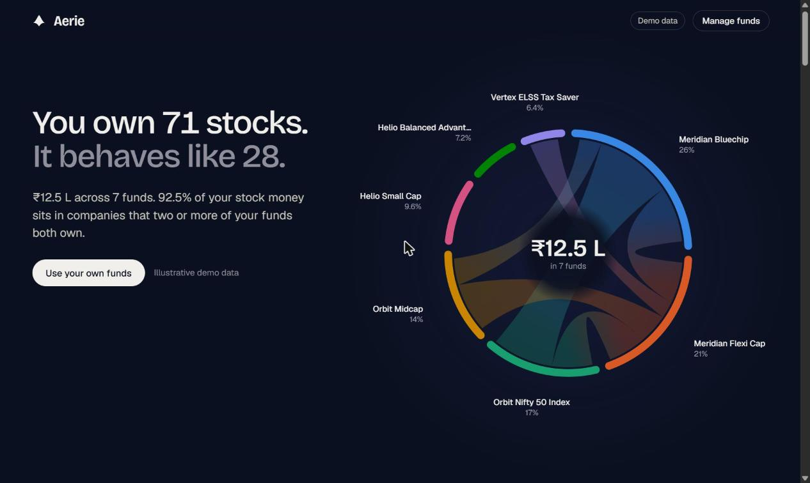
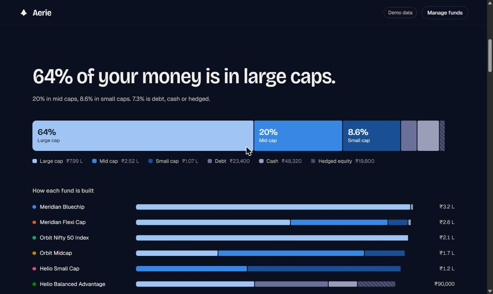
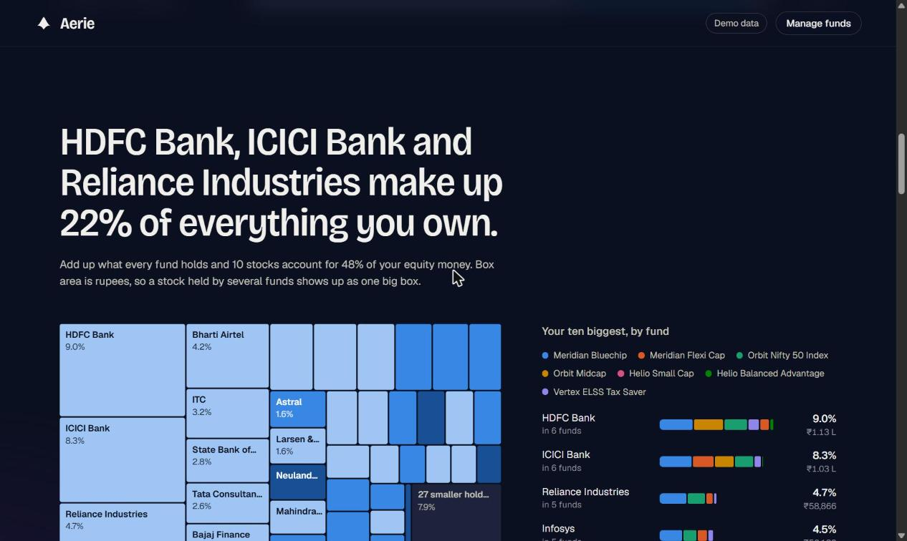
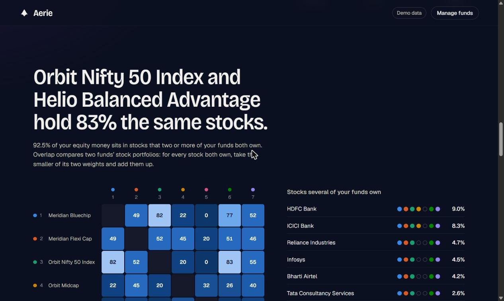
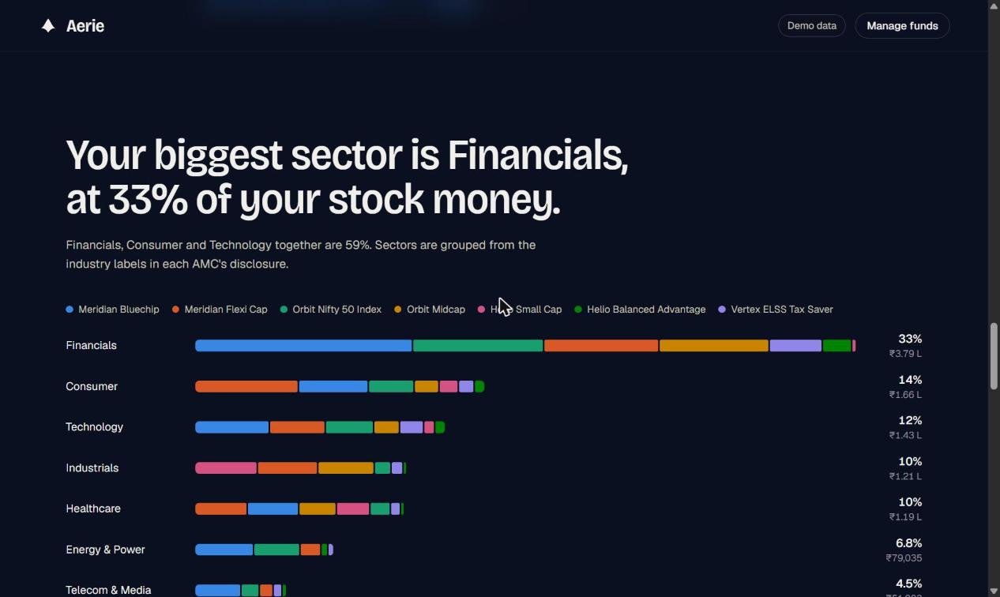
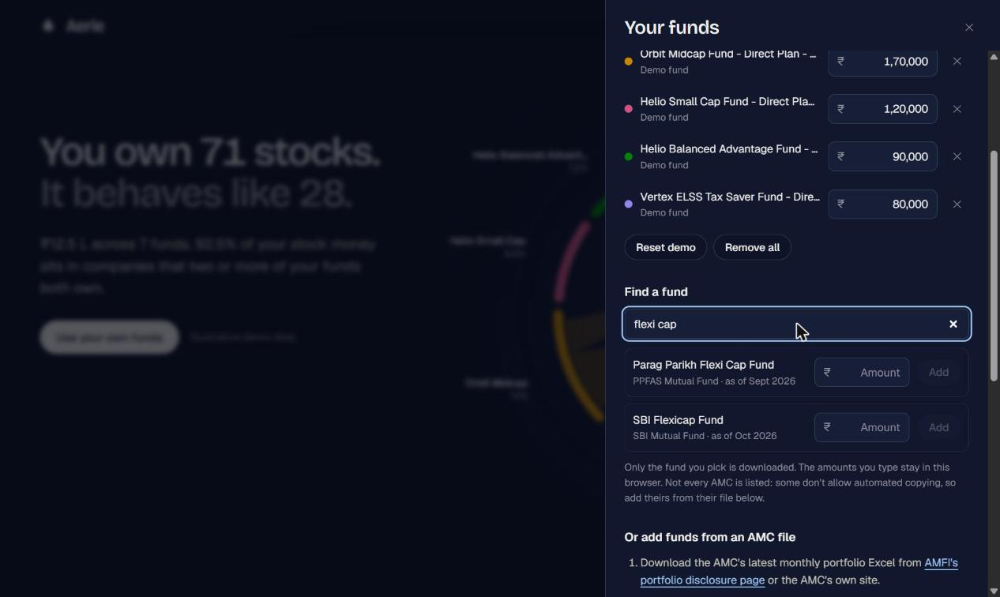
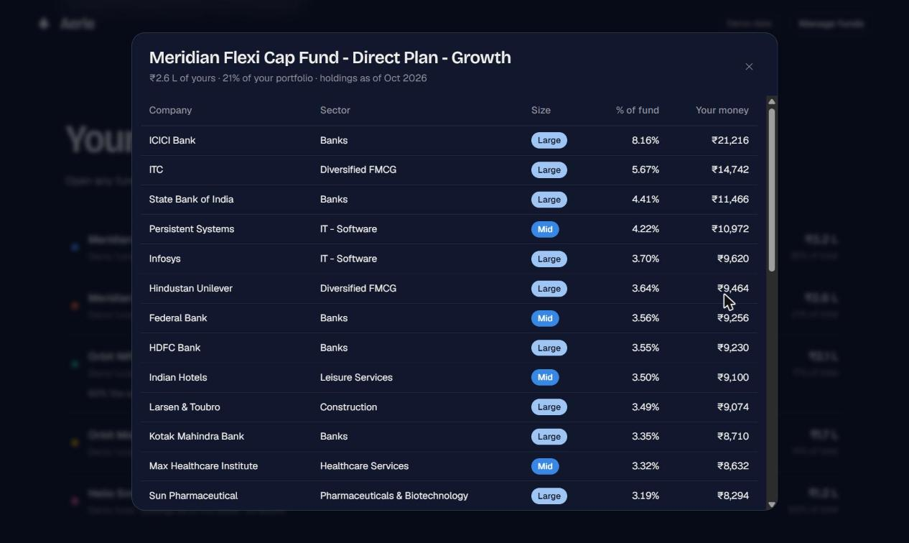

# Aerie

**See what is really inside your mutual funds.**

Aerie opens up every fund in your portfolio, lines up the stocks inside them, and shows where your funds overlap, how much of your money is in large, mid and small caps, and which sectors you are actually betting on. It is built for Indian mutual funds and runs entirely in your browser.



*Screenshots use the built-in demo data: fictional funds with generated weights.*

## Why

Five funds do not mean five bets. Two large-cap funds can hold the same twenty stocks. A "flexi cap" can be half large caps. Fund factsheets show one fund at a time, so the overlap stays invisible. Aerie adds the funds up the way your money actually sits.

- **Unique stocks** and **effective stocks**: how many companies you own, and how concentrated that is (the inverse Herfindahl index of your look-through weights: "as concentrated as holding N stocks in equal amounts").
- **Overlap** between any two funds, and the stocks several of your funds hold at once.
- **Size mix**: large, mid, small, plus debt, cash and hedged equity, per fund and overall.
- **Concentration**: your biggest stocks once every fund is added up.
- **Sectors**: where the money sits, and which funds put it there.
- **Fund sheets**: every holding of every fund, with its size, sector and the rupees it represents in *your* portfolio.
- **Ask** (optional): plain-language questions about your portfolio, answered by an AI model you choose.

## Privacy

Aerie is local-first. There is no account, no backend and no analytics.

- Your funds and amounts are stored in your browser's `localStorage` and nowhere else. **Export JSON** backs them up or moves them to another browser.
- Excel files you upload are parsed in your browser and never sent anywhere.
- Two features are optional and touch the network:
  - **Find a fund** downloads the holdings of the fund you pick from the companion [aerie-data](https://github.com/garuda8887/aerie-data) set. The host sees which fund you opened, never your amounts.
  - **Ask** sends names and percentages (never rupee amounts) to the AI provider you choose, with your own API key. See [Ask an AI model](#ask-an-ai-model-optional).

## Screenshots

| | |
| --- | --- |
|  |  |
|  |  |
|  |  |

## Quick start

Requires Node.js 20 or newer.

```bash
npm install
npm run dev          # http://localhost:5173
```

Other scripts:

```bash
npm test             # parser and analytics tests
npm run build        # static site in dist/
npm run build:single # one self-contained dist-single/index.html
npm run samples      # writes synthetic AMC and AMFI workbooks to ./samples
npm run ingest -- file.xlsx   # shows what the parser sees in an AMC file
```

To use **Find a fund** locally, clone [aerie-data](https://github.com/garuda8887/aerie-data) next to this repository (`../aerie-data`). The dev server serves its `data/` folder automatically.

## Using it with your own funds

1. Open **Manage funds**.
2. **Find a fund**: search by fund or AMC name, type how much you hold, press Add.
3. Not listed? Download the AMC's monthly portfolio Excel from the AMC's site or [AMFI's portfolio disclosure page](https://www.amfiindia.com/online-center/portfolio-disclosure), choose the AMC, drop the file in, tick the schemes you hold and enter the amounts. A workbook with many schemes imports in one go.
4. Optional but recommended: load AMFI's half-yearly **categorisation of stocks** Excel so every stock gets a Large / Mid / Small tag. Without it, stocks show as "size unknown".

### Which AMCs are in Find a fund, and why not all

There is no common API or file format for fund holdings: every AMC publishes its monthly Excel differently. Many forbid automated copying in their terms, block scripts, or list their files only through JavaScript or forms. Aerie does not work around any of that.

- **Find a fund** lists AMCs whose files can be fetched politely and whose terms were read. Today that is PPFAS and SBI.
- **Everything else works by upload.** Download the AMC's file yourself and drop it in. This is the supported path for most AMCs, not a fallback. Files from PPFAS, SBI, UTI, Motilal Oswal, HDFC, Bandhan and LIC have been tested against the real thing.

Per-AMC status and the policy are documented in [aerie-data](https://github.com/garuda8887/aerie-data).

## Ask an AI model (optional)

The **Ask** section turns the numbers into answers: "which of my funds duplicate each other?", "what am I really betting on?". It is the only part of Aerie that talks to an AI server, and only after you pick a provider, paste your own API key and ask a question.

- **Providers:** Claude (Anthropic SDK, with a model picker), plus anything that speaks the OpenAI chat-completions protocol: OpenAI, Google Gemini, OpenRouter, local servers such as Ollama or LM Studio, or any address you type in.
- **What leaves your browser:** fund and stock names and percentages (share of portfolio, cap, sector, overlap), sent only to the provider you picked. Never rupee amounts, never the Excel files. **What gets sent**, under the question box, shows the exact text.
- **The key** is kept in this browser's local storage. Anyone who can open your browser profile can read it, so use a key with a spend limit. **Remove key** deletes it. Keys are refused over plain http except to localhost.
- The model is told to explain and compare, not to say what to buy or sell.
- A local server must allow this page's origin (CORS), for example `OLLAMA_ORIGINS` for Ollama.

## How the numbers are computed

- **Look-through exposure** of a stock = your rupees in a fund × the stock's % of that fund's NAV, summed over funds.
- **Hedged equity.** Arbitrage and balanced-advantage funds hold equities and short futures against them. If a fund's short derivatives offset part of its equity, that part is treated as hedged money, not stock exposure, and is excluded from overlap. This is proportional scaling; real hedges are stock-specific, so it is an approximation.
- **Overlap** between two funds: scale each fund's stock weights to sum to 1, then add the smaller weight of every stock both hold. 0 means nothing shared, 100% means identical portfolios.
- **Redundancy**: the share of your equity rupees sitting in stocks held by two or more of your funds.
- **Size**: AMFI's list (top 100 by market cap = large, 101 to 250 = mid, the rest = small), joined by ISIN. Overseas holdings are tagged separately.
- **Sectors**: AMCs label equities with AMFI's industry classification. Aerie keeps the raw label and folds it into ten macro sectors (`src/core/sectors.ts`).
- Holdings are as of the file's date, usually the previous month-end. Your amount is today's value. The gap is real; expect small differences from a live view.

## How the parser works

SEBI mandates *what* AMCs disclose (instrument, ISIN, industry or rating, quantity, market value, % to NAV) but not the file layout. Instead of one parser per AMC, `src/core/parseAmc.ts`:

1. finds the header row by its labels (a row with an ISIN column and a % or value column),
2. maps columns by label, not position (including label/value headers such as `SCHEME NAME :` and Excel serial dates),
3. walks the rows tracking section headings (equity, debt, derivatives, cash),
4. classifies each line from its ISIN (`INE…01…` equity, `INF…` fund units, other `INE` debt, `IN0…` G-secs) and section,
5. handles % stored as `5.2`, `0.052` or `"5.2%"`, or derives % to NAV from market value when a file has no % column,
6. skips index and summary sheets, and stops at the grand total.

It is tested on trimmed, de-identified copies of real layouts (`tests/fixtures.ts`, `tests/review.test.ts`). A file the parser misreads is the most common kind of bug report; `npm run ingest` and [docs/ADDING_AN_AMC.md](docs/ADDING_AN_AMC.md) describe the debugging loop.

## Project layout

```
src/core/        parsing, analytics, formatting, demo data, state (no UI code)
src/components/  one file per dashboard section; Orbit.tsx is the canvas hero
tests/           vitest: parser fixtures and analytics maths
scripts/         ingest.ts (debug a file), make-samples.ts (sample workbooks)
docs/            data sources, adding an AMC, screenshots
```

Stack: Vite, React, TypeScript, d3-hierarchy for the treemap, a canvas for the orbit, SheetJS (`xlsx`) for Excel, plain CSS. Fonts (Bricolage Grotesque, Geist) are bundled, so it works offline.

## Deploying

`npm run build` produces a static site in `dist/`; host it anywhere (GitHub Pages, Netlify, your own server).

### Find a fund when you self-host

> **Heads-up:** a freshly built copy of Aerie does not come with fund data. Until you give it some, **Find a fund** shows "Couldn't load the fund list" and everything else, including file upload, works normally. A hosted Aerie website, if there ever is one, would ship with the data already in place.

The fund data is a folder of static JSON files from [aerie-data](https://github.com/garuda8887/aerie-data). There is no server to run. Pick one:

1. **Copy it next to the app.** Copy aerie-data's `data/` folder into your deployed site as `fund-data/` (so `fund-data/index.json` exists). No configuration needed.
2. **Host it anywhere and point Aerie at it.** Build with `VITE_FUND_DATA_URL=https://your-host/path` (the folder that contains `index.json`). The host needs to allow cross-origin requests (CORS).
3. **Populate it yourself.** Run aerie-data's `npm run build` for the AMCs you want and host the resulting `data/` as above. See its README for the fetching policy and how to add an AMC.

The data refreshes when you re-run aerie-data's build, so schedule that (for example a monthly job) if you want the funds kept current. `npm run build:single` makes one standalone HTML file, so it needs option 2.

## Known limitations

- `xlsx@0.18.5` is the last SheetJS build on npm and has published advisories for crafted files. Aerie only reads files you choose, in your own browser, but you can swap in SheetJS's newer CDN build (see docs.sheetjs.com) if you want it patched.
- Debt funds are shown as a "Debt" bucket; there is no issuer-level look-through for bonds.
- Fund-of-funds, gold and silver funds show as a single line; there is no look-through to their underlying funds or commodity.
- Funds past the eighth share a neutral colour (the palette is validated for eight hues).

## Roadmap

- Look-through for ETFs and fund-of-funds.
- NPS scheme portfolios.
- Units, buy price and dates, for returns (XIRR) on the same position model.
- Auto-refresh of the AMFI cap list.
- A hosted site with Find a fund and its data included.
- More AMCs in Find a fund, as they allow it.

## Disclaimer

Aerie is a way to look at your money. It is not investment advice. Holdings data comes from AMCs' public monthly disclosures, so it lags and can contain errors; check the AMC's own disclosure before relying on it. Aerie is not affiliated with, or endorsed by, any AMC, AMFI or SEBI. Fund and AMC names belong to their owners.

## License

MIT. See [LICENSE](LICENSE).
